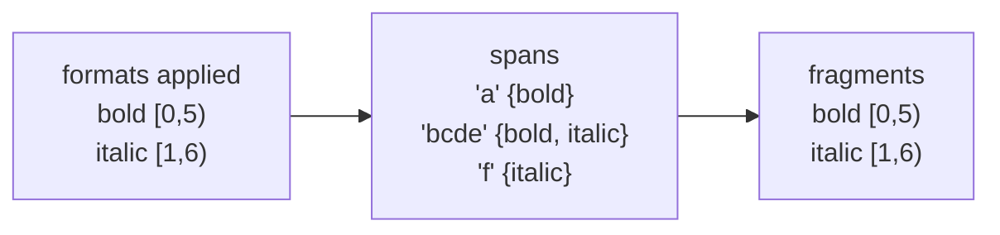

# Data Model

`EditorJSModel` is the source of truth. All document mutations go through it.

Internally it owns an `EditorDocument` (ordered `BlockNode[]`) and a `CaretManager` (one caret per `userId`).

## Document tree

Each `BlockNode` contains keyed data nodes:

- `TextNode`: rich text. Inline formatting is stored as spans: pieces of text with the set of formats (inline tool + data) applied to every character. Spans are canonical (no empty spans, neighbours never have equal format sets, at most one format per tool), so the same formatting always gives the same state. `getFragments()` derives maximal fragments from the spans, sorted by start, then end descending, then tool name.
- `ValueNode<T>`: non-text typed value for tools.
- `BlockTune`: per-block tune configuration.

## Inline formatting terms

The same formatting appears under three names, one per layer:

- **Format** (`format()` / `unformat()`, `TextFormattedEvent`, `FormattingAdapter`): applying or removing an inline tool over a text range. An **`InlineFormat`** is what gets applied: the tool and its data, without a range.
- **Span** (internal): `TextNode` stores its text as **`FormattedText`**, an ordered list of **`TextSpan`**s. A span is a piece of text with the `InlineFormat`s that apply to every character in it. Spans never overlap and are kept canonical.
- **Fragment** (public, serialized): an **`InlineFragment`** is one `InlineFormat` over a range. Fragments can overlap. `getFragments()`, `serialized` and the API derive them from the spans.

Text `abcdef` with bold over `[0, 5)` and italic over `[1, 6)`:



## Mutation and event invariant

- Nodes dispatch internal change events when they mutate.
- `EditorJSModel` listens and re-dispatches a normalized stream for consumers.
- Consumers should subscribe to `EditorJSModel` events instead of listening to deep nodes.


→ [`diagrams/model-tree-structure.mmd`](diagrams/model-tree-structure.mmd)

_Node hierarchy. Document tree (left): `EditorJSModel` → `EditorDocument` → `BlockNode` → data nodes. Caret (right): `CaretManager` holds per-user `Caret` instances. All nodes extend `EventBus`._

## Caret & selection

`CaretManager` stores one `Caret` per collaborating user. Each `Caret` holds an `Index`: a serializable selection structure that can span blocks/data keys.

When a caret changes, `EditorJSModel` exposes that update under `EventType.CaretManagerUpdated` so the rest of the system can react without reading DOM state directly.

## Index

`Index` is the universal address type used throughout the system — for event locations, caret positions, and OT operation targets. It is DOM-independent and fully serializable.

### Class hierarchy

```
IndexBase (abstract)
├── DocumentIndex   — entire document
├── PropertyIndex   — top-level document property
├── BlockIndex      — a single block
├── DataIndex       — a data key inside a block
├── TuneIndex       — a key inside a block tune
└── TextIndex       — character range(s) inside a text node
```

`Index` is a separate abstract class that extends `IndexBase` and holds only static factory methods — it is never instantiated directly. All concrete classes extend `IndexBase`.

### Narrowing

Each index carries a `kind` discriminant (`IndexKind` enum). Use it — or `instanceof` — to narrow before accessing type-specific fields:

```ts
if (index.kind === IndexKind.Text) {
  // index is TextIndex — access index.blockIndex, index.dataKey, index.textRange
} else if (index instanceof BlockIndex) {
  // access index.blockIndex
}
```

### Construction

Use the static factory methods on `Index`:

```ts
Index.document(documentId)
Index.property(name, documentId?)
Index.block(blockIndex, documentId?)
Index.data(blockIndex, dataKey, documentId?)
Index.tune(blockIndex, tuneName, tuneKey, documentId?)
Index.text(segments)
Index.parse(serialized)        // deserialize from string
```

### Serialization

`index.serialize()` produces a compact JSON string; `Index.parse(serialized)` is the inverse. The format is documented in [Index Serialization Format](index-serialization.md).
